# PRD – Unified Inbox for teams: labels, and who did what

**Design of record:** [prototype](https://product-team-sh.github.io/prd-unified-inbox-labels/prototype/) · **Status:** Ready for dev review

The prototype is built on the production Unified Inbox (webui `main` at `2ae90d3`, production stylesheet), so anything not outlined in purple is today's product. These are review aids, not product UI:

- the dark strip at the top (Show web or mobile, Viewing as, Jump to a step, Highlight what's new, Reset)
- the purple dashed outlines, which mark what is new
- the simplified app rail and page header

---

## 1. Problem

- **Nobody can tell who did what in a shared inbox.** A reply sent from the inbox shows the mailbox's name, so when several people reply from one mailbox the team can't tell who answered. Outcome changes leave no trace of who made them.
- **A delete removes the thread for everyone, with no name and no way back.** In one escalated account, threads deleted by one team member emptied the inbox for the whole team. Support recovered them from the backend more than once and needed a tech ticket to find out who deleted them ([escalation](https://app.basecamp.com/4378325/buckets/16408283/todos/10049758002)).
- **Teams have no way to organise threads beyond the outcome.** Teams fall back to Gmail labels to mark who is on what ([check-in](https://3.basecamp.com/4378325/buckets/15549277/question_answers/10389240675)).

## 2. Why this approach

| Approach | Decision |
|---|---|
| Owner field and assignment (Mine / Unassigned views, handover) | Rejected: adds process the team did not ask for. Labels and "Sent by" cover the visibility need. |
| Warning before a duplicate reply | Rejected for now (see D4 and OQ4). |
| Per-person visibility (each person sees only their own replies) | Out of scope. Two accounts asked for it; per-client separation is Workspaces. |
| **Labels plus attribution of every team action** | **Chosen.** |

**Evidence** (searched 11 Oct 2026: Basecamp, Jira across all projects, Intercom export):

- 1 escalation about deletes nobody could trace (measured).
- 2 asks to restrict who sees which replies, and 1 ask to route replies to a manager who hands them out (measured). Both are out of scope here.
- 0 customer asks for labels. The only ask is the internal check-in (measured).
- Intercom coverage: 26,854 of about 129,000 closed conversations, subject and first message only, up to 21 Aug 2026 (measured). Live Intercom was not searched.
- How many paying accounts have two or more users replying from the inbox: **not measured** (OQ1).

We do not claim demand for labels from customers. The case rests on attribution (the escalation) and on the internal ask.

## 3. What we're building

1. **Every team action in a thread names the teammate:** each reply, each outcome change, each delete and restore.
2. **Labels on threads,** shared by the workspace, shown on the row and in the thread, and filterable.
3. **Delete moves a thread to Deleted for 30 days, for everyone,** with who deleted it and a Restore.

Invariant: everyone in a workspace still sees the same threads. Nothing here changes who can see what.

## 4. User stories

| ID | Story |
|---|---|
| US1 | As a teammate, I see which teammate sent each reply, so I know who is handling a prospect. |
| US2 | As a teammate, I see who changed an outcome and when, so a wrong outcome can be traced and fixed. |
| US3 | As a teammate, I label a thread and create a label when none fits, so the team can group work its own way. |
| US4 | As a teammate, I filter by label or by who replied, so I can see one topic or one person's work. |
| US5 | As a teammate, I am told a delete affects everyone before I confirm it. |
| US6 | As an admin, I find a deleted thread, see who deleted it and restore it, without asking support. |
| US7 | As a mobile app user, I can do US1 to US4 and US5 on my phone. |

## 5. Decisions

**D1 – Labels belong to the thread, not the prospect.** A prospect in two sequences has two threads that may need different labels. **Consequence to accept explicitly:** labels are a second concept next to prospect Tags. The name and whether to share data with Tags is OQ2.

**D2 – One label style, no colour per label.** Labels use the design system's tag (`ProspectTag`, `bs-tag bs-tag-blue-17`). **Consequence:** labels can't be told apart by colour, only by name.

**D3 – Labels are shared by the workspace, and anyone can create one.** **Consequence:** near-duplicates ("Follow up", "Follow-up") are possible. Rename, merge and delete of labels is OQ3.

**D4 – No owner field, no assignment, no duplicate-reply warning.** **Consequence:** two teammates can still reply to the same thread before either sees the other's reply.

**D5 – Delete is recoverable for 30 days by anyone in the workspace, then permanent.** The confirmation names who will lose the thread. **Consequence:** deleted threads are stored for 30 days. Whether today's delete is permanent is a dependency (§9).

**D6 – Outcomes set by automatic categorisation say "automatically",** not a person's name.

**D7 – "Replied By" matches a thread if that teammate sent any reply on it.** The row shows the latest replier.

**D8 – Replies sent straight from the mailbox (outside Saleshandy) show "Sent outside Saleshandy",** because the sender is unknown.

**D9 – Label and Replied By filters live in the existing Filters drawer.** Clicking any label also filters by it. There is no new filter control in the top row.

**D10 – Labelled rows grow from 106px to 138px; unlabelled rows stay 106px.** A row shows 2 labels, or 1 and "+N" when there are more than 2 (`ProspectTagsRow`'s rule). **Consequence:** fewer rows fit on screen when many threads are labelled.

**D11 – Read and unread stay shared by the team.** Per-person read state is out of scope.

## 6. Surfaces

### 6.1 Inbox list (web)

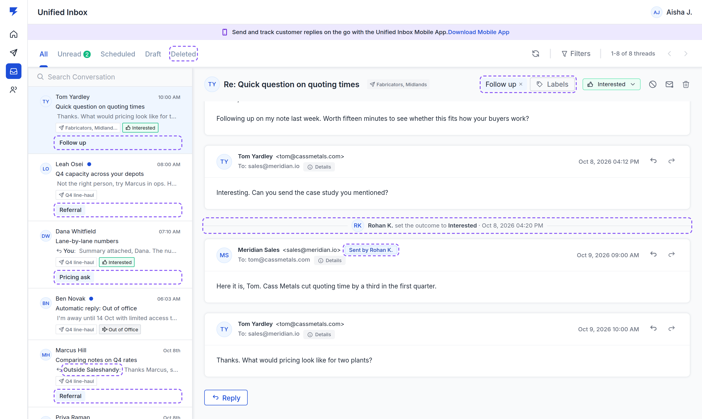

- When the last message is a team reply, the snippet prefix names the sender: "You:" for me, the teammate's name for others, "Outside Saleshandy:" when sent from the mailbox directly. Today it always says "You:".
- Labels sit on their own line under the sequence and outcome pills (D10). Clicking a label filters the list by it.
- A **Deleted** tab after Draft, with a count. See §6.4.
- An unlabelled row is unchanged from production.

### 6.2 Thread (web)

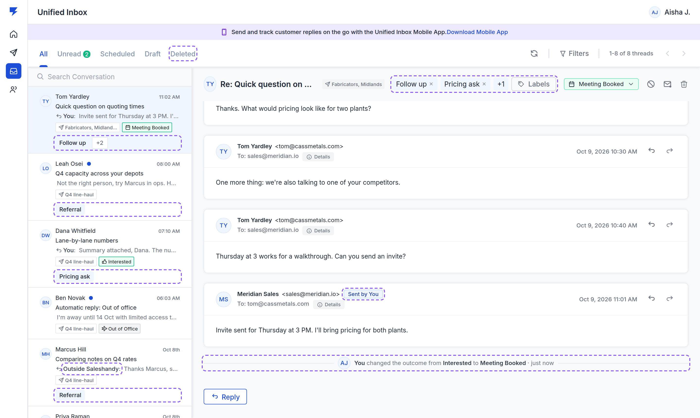

- **Header:** label tags with × (`ProspectTagWithCancel`) sit left of the Outcome control, then "+N" when there are more than 2, then a **Labels** `tag-button` that opens the label menu (§6.3). Clicking a label name filters by it.
- **Each team reply** carries a tag after the mailbox address: "Sent by [name]" (or "Sent by You"), "Sequence, step [n]" for sequence emails, "Sent outside Saleshandy" (D8).
- **Activity lines** sit between messages in time order:

| Event | Copy |
|---|---|
| Outcome set by a person, from Uncategorized | *"[Name] set the outcome to [Outcome] · [time]"* |
| Outcome changed by a person | *"[Name] changed the outcome from [A] to [B] · [time]"* |
| Outcome set automatically | *"Outcome set to [Outcome] automatically · [time]"* |
| Deleted | *"[Name] deleted this thread · [time]"* |
| Restored | *"[Name] restored this thread · [time]"* |

- The Outcome menu adds one line: *"Your name is saved with the change."* The toast after a change offers **Undo**, which removes the change and its line.
- The reply box shows *"Sending as [name] from [mailbox]"*.

### 6.3 Labels menu

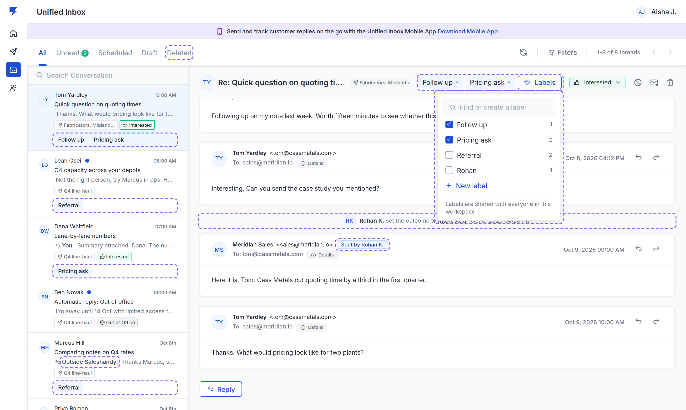

| State | Content |
|---|---|
| Open | Search box *"Find or create a label"*, every label with a checkbox and its thread count, **New label**, hint *"Labels are shared with everyone in this workspace."* |
| Typing a name that doesn't exist | Last row becomes *Create label "[text]"*. Enter on an exact match ticks it. |
| New label | Name field, *"Everyone in this workspace will see and can use this label."*, Cancel / **Create**. Created labels are added to the thread. |
| Duplicate name (any case) | *There is already a label called "[name]".* Create disabled. |
| Over 30 characters | *Keep it to 30 characters.* Create disabled. |

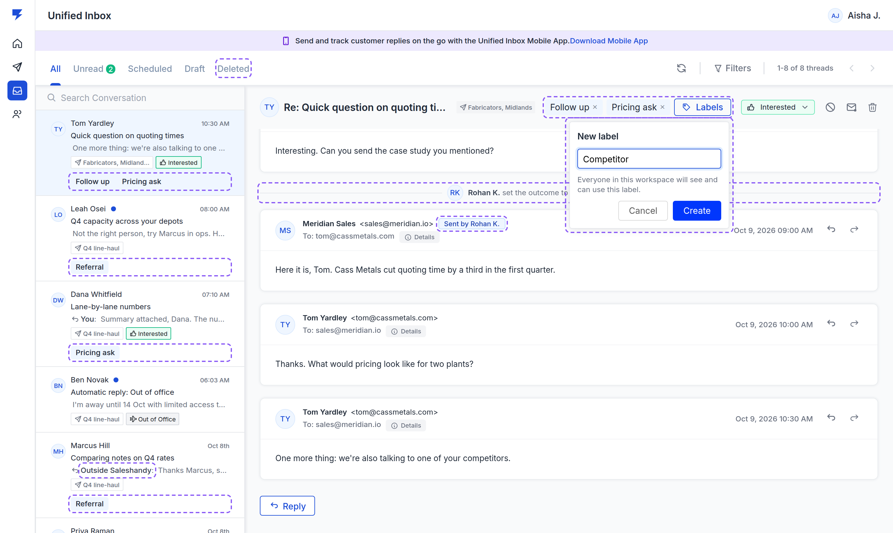

### 6.4 Delete and Deleted

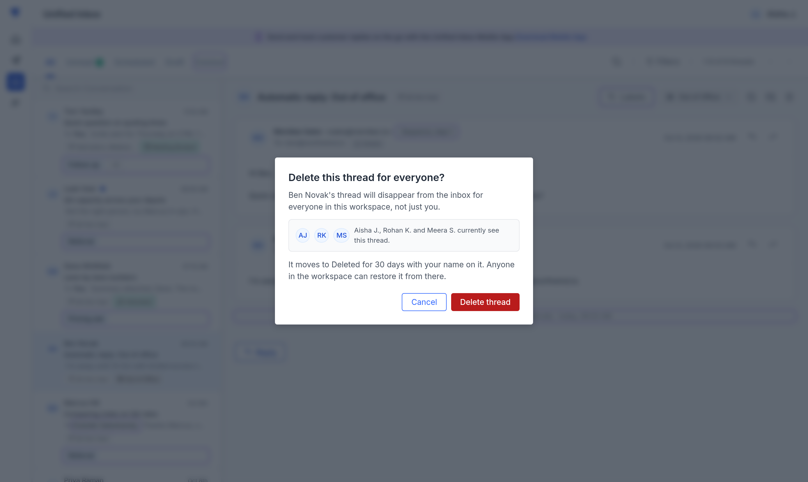

- Delete asks first: **"Delete this thread for everyone?"**, *"[Prospect]'s thread will disappear from the inbox for everyone in this workspace, not just you."*, the people who currently see it, *"It moves to Deleted for 30 days with your name on it. Anyone in the workspace can restore it from there."* Buttons: Cancel (focused) / **Delete thread**.
- After delete: toast *"Thread deleted for everyone. It stays in Deleted for 30 days."* with **Undo**.
- **Deleted tab:** rows show *"Deleted by [name] · [time]"*. The open thread shows a banner *"[Name] deleted this thread [time]. It will be removed for good on [date]."* with **Restore**, and is read-only.

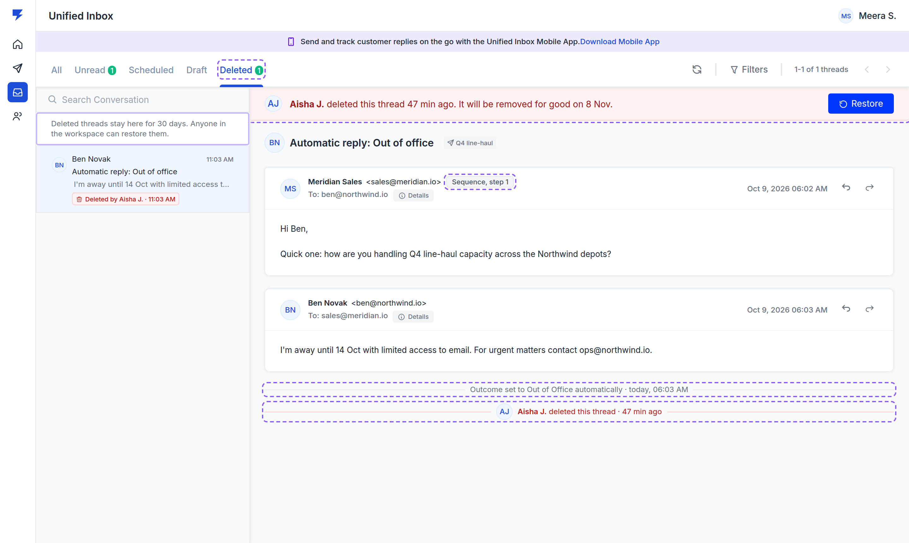

### 6.5 Filters drawer

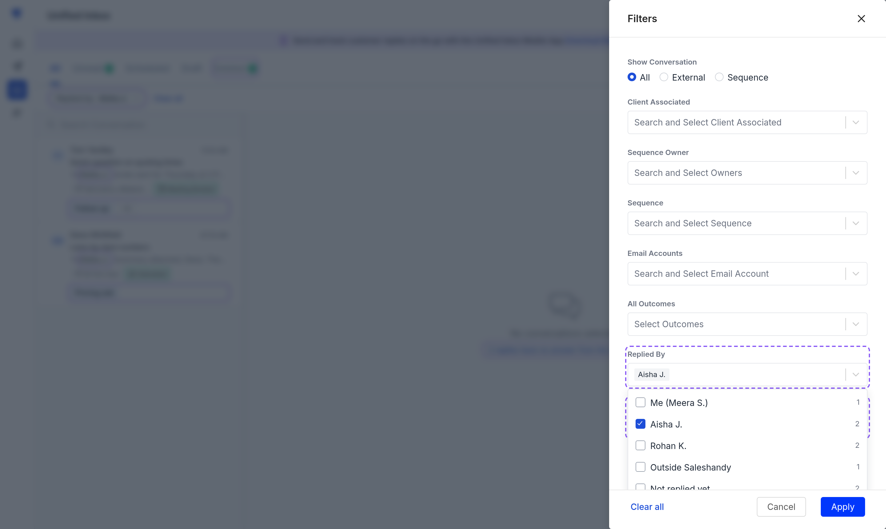

- Two new fields after **All Outcomes**: **Replied By** (*Select Teammates*: Me first, then teammates, then "Outside Saleshandy", then "Not replied yet") and **Labels** (*Select Labels*). Each option shows its thread count.
- Applied filters show in the existing applied-filter bar, e.g. *"Labels: Referral ×"*.
- Every existing field is unchanged.

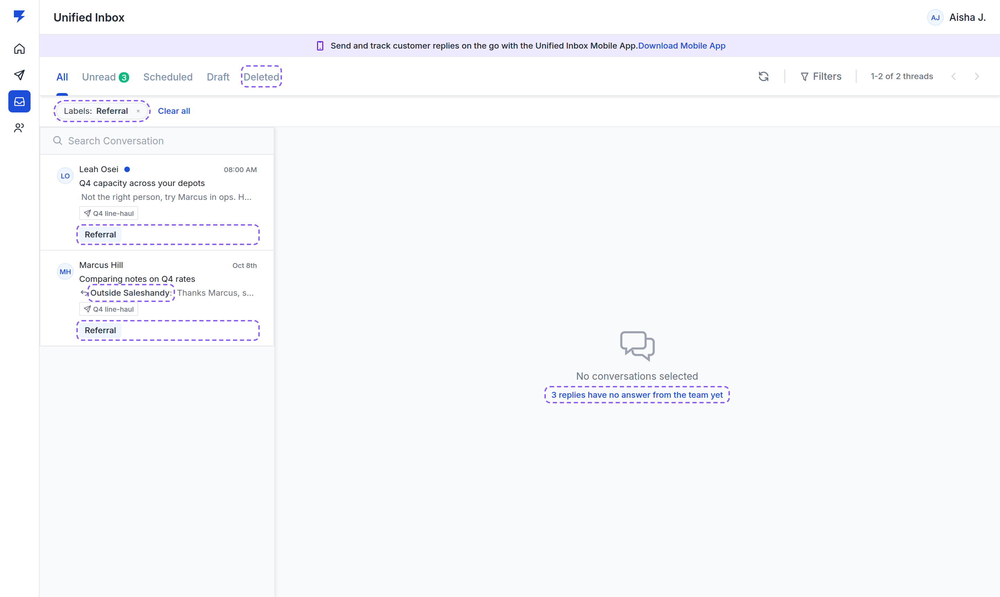

### 6.6 Mobile app

| List | Thread | Labels sheet | Delete | Replied by |
|---|---|---|---|---|
| [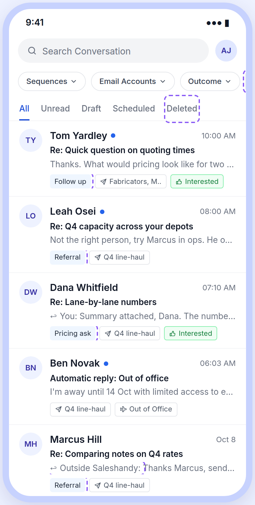](screens/10-mobile-list.png) | [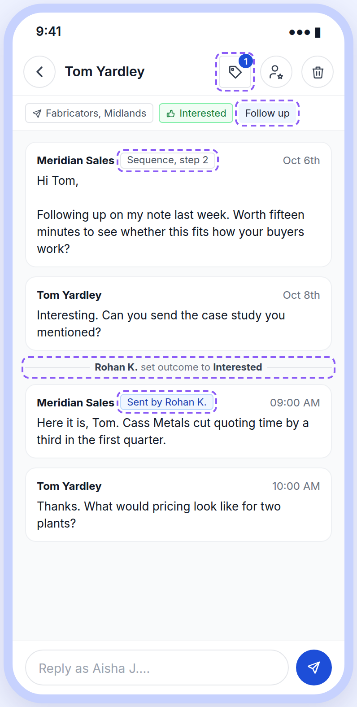](screens/11-mobile-thread.png) | [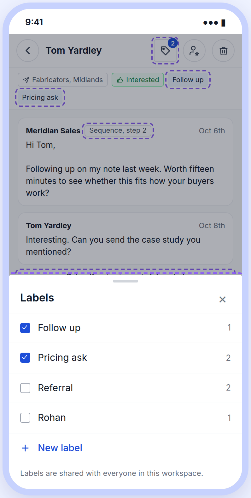](screens/12-mobile-labels.png) | [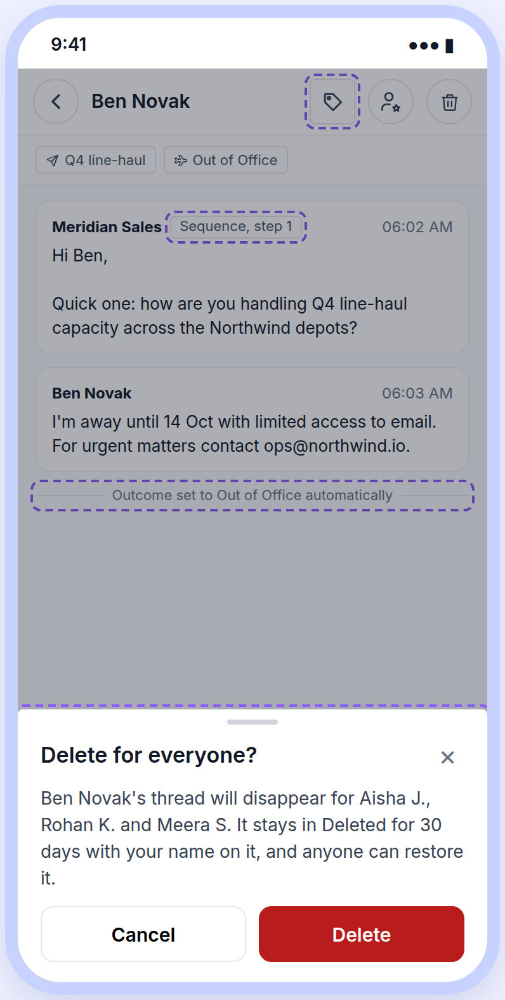](screens/13-mobile-delete.png) | [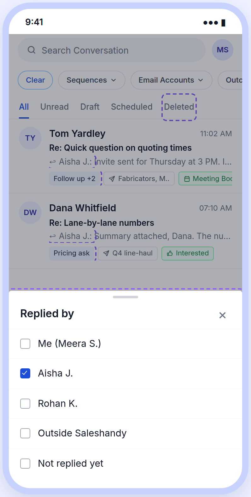](screens/14-mobile-replied-by.png) |

- Rows: label tag first, then sequence and outcome; the snippet names the replier.
- Filter chips: **Replied by** and **Labels** after Outcome.
- Thread: a tag icon beside the outcome icon opens a **Labels** sheet (tick, New label). Replies show "Sent by"; activity lines as §6.2.
- Delete opens a sheet: *"Delete for everyone?"* with the same copy. A **Deleted** tab after Scheduled.
- Drawn from the app's [help-centre screenshots](https://docs.saleshandy.com/en/articles/10411739-saleshandy-mobile-app-for-lead-management), not its code (OQ6).

**Explicitly out of scope:** owner and assignment, per-person visibility, per-person unread, label colours, bulk add or remove labels (OQ5), labels in reports.

### Acceptance criteria

| ID | Case | Expected | P |
|---|---|---|---|
| A1 | Teammate B sends a reply in a thread | The reply shows "Sent by [B]"; for B it reads "Sent by You". The row snippet starts with B's name for everyone else. | P0 |
| A2 | A reply is sent from the mailbox outside Saleshandy | Shows "Sent outside Saleshandy", never a person's name | P0 |
| A3 | Teammate changes the outcome | A line names them, the old and the new outcome, and the time. Undo removes both the change and the line. | P0 |
| A4 | Automatic categorisation sets an outcome | Line reads "set to [Outcome] automatically", no name | P0 |
| A5 | Add a label from the menu | Tag appears in the header and on the row for every teammate, without a reload | P0 |
| A6 | Create a label whose name exists in another case | Blocked with the duplicate message | P1 |
| A7 | Thread with 3 labels | Row shows 1 tag + "+2"; header shows 2 tags + "+1" | P1 |
| A8 | Click a label on a row or in the header | List filters to that label; the applied-filter bar shows it | P1 |
| A9 | Replied By = teammate B | Only threads where B sent at least one reply | P0 |
| A10 | Replied By = Not replied yet | Only threads with no team reply and no outside reply | P1 |
| A11-F | Delete a thread, then restore it within 30 days | Restored thread has every message, label and outcome it had; both lines are in its history. **Sign off by name, owner: [dev lead, TBD].** | P0 |
| A12 | Delete confirmation | Names the people who currently see the thread; Cancel has focus | P0 |
| A13 | Teammate opens Deleted | Sees the thread with "Deleted by [name] · [time]" and Restore | P0 |
| A14 | Day 31 after delete | Thread is gone from Deleted and cannot be restored | P1 |
| A15 | Mobile: change outcome, add a label, delete | Same records and lines as web, visible on web straight away | P0 |
| A16 | Unlabelled row | Pixel-identical to production (106px) | P1 |

## 7. Reconciliation with existing behaviour

| Existing | Relationship |
|---|---|
| **All Outcomes** filter (Filters drawer) | Unchanged. It already filters by outcome; nothing new is added for outcomes. |
| **Sequence Owner** filter | Different question: who owns the sequence. **Replied By** is who answered. Both stay. |
| **Prospect Tags** and the Tags filter, which the inbox currently excludes | Labels are separate (D1). The inbox keeps excluding the Tags filter unless OQ2 decides otherwise. |
| Activity modal (opens and link clicks) | Unchanged. The new lines are in the thread, not the modal. |
| Bulk actions (outcome, read, unread, delete) | Bulk delete must record the actor per thread and land in Deleted, the same as a single delete. |
| Open API outcome updates | An outcome changed through the API must record an actor (D6 copy for the API is OQ7). |

## 8. Cross-cutting

| Requirement | Level |
|---|---|
| Every reply, outcome change, delete and restore stores who did it and when, from web, mobile and bulk actions | Release blocker |
| The name shown is the teammate's current name, read when displayed | P1 |
| Removing a user from the workspace keeps their name on past actions | P0 |
| Labels and Deleted are per workspace and never visible across workspaces | Release blocker |

## 9. Implementation notes

Not prescriptive. Dependencies to confirm **before estimation**:

- Whether a sent reply records which user sent it today, or only the mailbox. "Sent by" depends on it.
- Whether today's delete is permanent. If it is, D5 is new storage, not a filter.
- Whether outcome changes from automatic categorisation, bulk actions and the Open API are told apart from a person's change.
- Mobile app: the same records and filters through its API (no mobile repo was available to this review).

## 10. Measurement

**Privacy:** never log label names or message text in analytics events; IDs only.

| Event | Fires when | Properties |
|---|---|---|
| `Inbox Label Applied` | A label is added to a thread | label id, thread id, source (web, mobile) |
| `Inbox Label Created` | A label is created | label id |
| `Inbox Filter Applied` | Replied By or Labels filter applied | filter, value count |
| `Inbox Thread Deleted` / `Restored` | Delete or restore | thread id, source, bulk (yes or no) |

| Metric | Healthy | Investigate |
|---|---|---|
| **Leading:** share of multi-user workspaces that apply a label in the first 14 days (target) | 20% or more (target, a first guess with no baseline) | Under 5% |
| Restores per 100 deletes | Under 10 (target) | Over 25: deletes are being regretted, revisit the confirmation |
| **Lagging (day 30):** support tickets about deleted or missing inbox threads | Down from the 30 days before launch | Flat or up |

| Guardrail | Threshold | Action |
|---|---|---|
| Inbox list load time | Worse by more than 20% (target) | Roll back the labels line |
| Any action stored without an actor | More than 0 | Halt rollout |

Instrumentation ships with the feature.

## 11. Rollout

| Stage | Who | Gate |
|---|---|---|
| 1 | Internal workspaces (blast-radius control, not an A/B test) | A1 to A16 pass; no action stored without an actor |
| 2 | 10% of multi-user workspaces | 14 days, guardrails clear |
| 3 | Everyone, web and mobile together | Stage 2 clear |

No stage starts until the §9 dependencies are confirmed.

## 12. Open questions

| # | Question | Why it matters | Recommendation |
|---|---|---|---|
| OQ1 | How many paying accounts have 2+ users replying from the inbox? | Sizes the work against other priorities | Pull from Metabase before estimation. **Blocking for priority.** |
| OQ2 | Labels, or reuse prospect Tags? | One concept or two in the product | Keep thread labels (D1); name them "Labels" so they don't clash with Tags. **Blocking.** |
| OQ3 | Who can rename, merge and delete labels? | Stops label sprawl | Admins only; anyone creates. |
| OQ4 | Add a warning before a duplicate reply later? | D4 leaves the race open | Ship without; read support tickets at day 30. |
| OQ5 | Bulk add or remove labels? | Volume users will ask | Phase 2, through the existing bulk bar. |
| OQ6 | Mobile app design and effort | Drawn from screenshots only | Mobile dev reviews §6.6 before estimation. |
| OQ7 | Actor shown for Open API outcome changes | API changes have no person | Show "via API". |

## 13. Priority & timeline

Priority: TBD after OQ1 · Target: TBD · Release gate: §11 stage 1 · Owners: PM Hitesh Agrawal; dev lead TBD; mobile dev TBD; QA TBD.

## Appendix – reference index

- Design of record: [prototype](https://product-team-sh.github.io/prd-unified-inbox-labels/prototype/) (production webui `main` `2ae90d3` and its stylesheet; design-system components `ProspectTag`, `ProspectTagWithCancel`, `ProspectTagsRow`, `AddRemoveTag` tag-button, `transfer` dropdown).
- Origin: [check-in suggestion](https://3.basecamp.com/4378325/buckets/15549277/question_answers/10389240675).
- Mobile app: [help-centre article](https://docs.saleshandy.com/en/articles/10411739-saleshandy-mobile-app-for-lead-management).
- User-voice research (internal, not published): 11 Oct 2026 sweep of Basecamp, Jira and Intercom.
